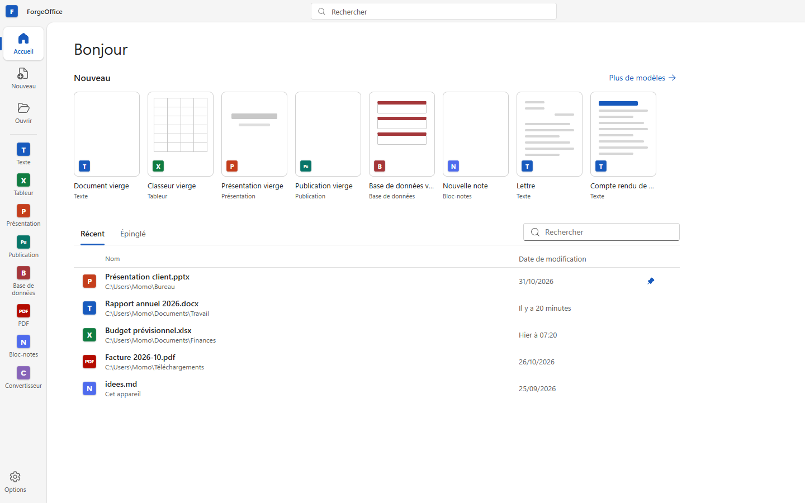
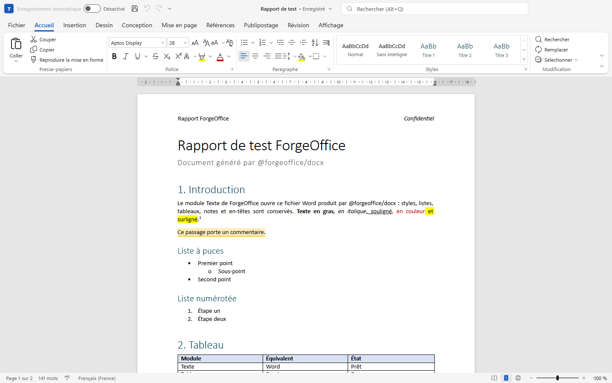
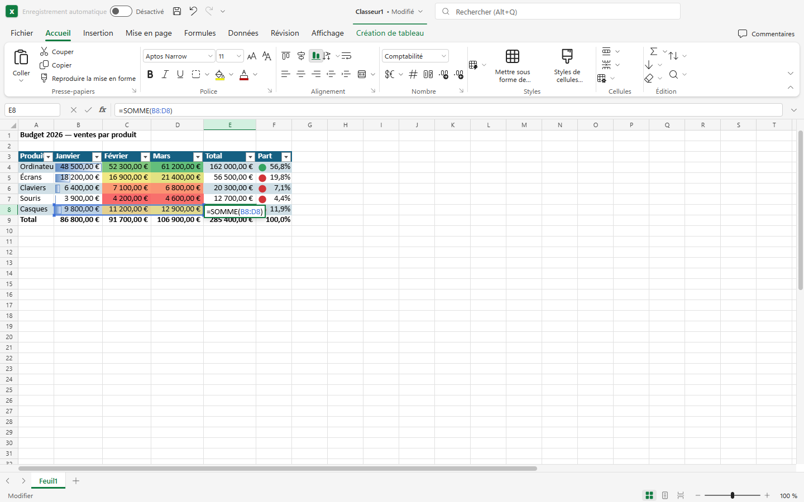
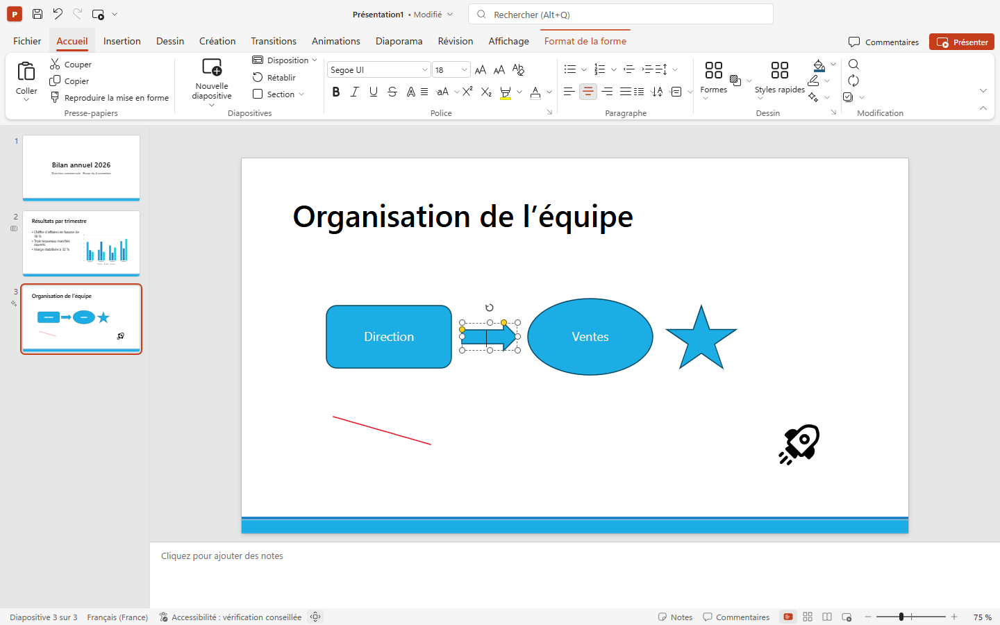
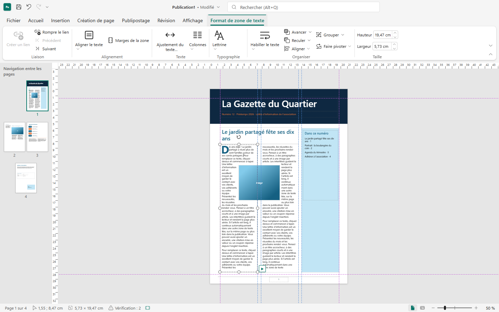
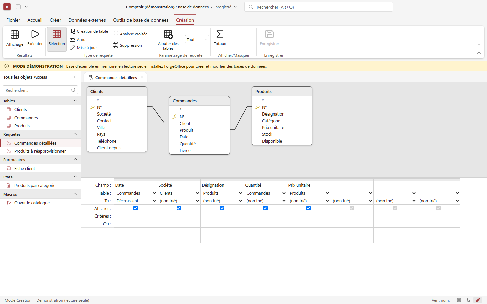
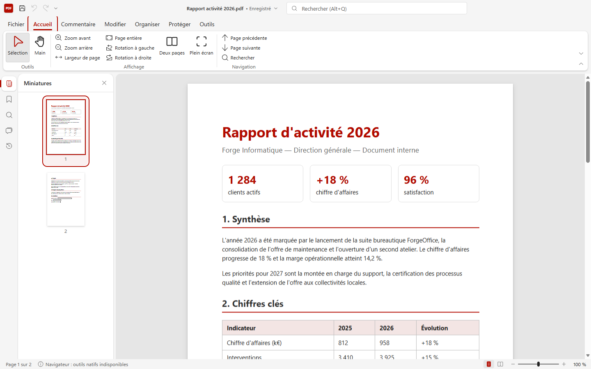
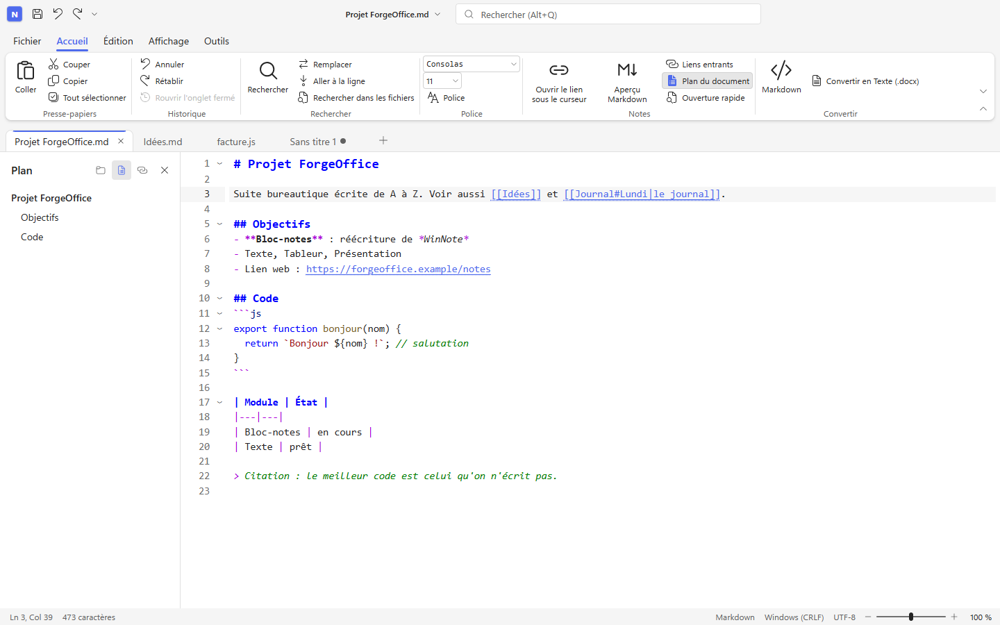

# ForgeOffice

Suite bureautique **locale d'abord**, écrite de A à Z, entièrement en français : Texte, Tableur, Présentation, Publication, Base de données, PDF, Bloc-notes et Convertisseur. L'esthétique suit Microsoft Office 2024 / Microsoft 365 (Fluent 2), les formats Office s'ouvrent et s'enregistrent directement.

- **Tout fonctionne hors ligne** : aucun serveur, aucun compte, aucune télémétrie. Les documents restent sur la machine ; la seule requête réseau est la vérification de mise à jour (désactivable).
- **Une seule application, huit modules** : un accueil, une fenêtre par document, un ruban Office dans chaque module.
- **Plateformes** : Windows 64 et 32 bits, Linux, macOS (Apple silicon et Intel), Android ; iOS prévu (construction sur Mac). Le même code tourne aussi dans un navigateur, ce qui sert de banc de test.
- **Stack** : Tauri 2 (coquille Rust) + React 19 + TypeScript strict. Moteurs natifs en Rust : SQLite pour la base de données, `lopdf` pour les PDF et les conversions.

> **État** : version 0.2.2. Le code des huit modules est écrit et testé (voir « État d'avancement »). Les installeurs Windows (64 et 32 bits) ont été installés, ouverts avec chaque type de fichier, fermés, mis à jour et désinstallés sur un vrai PC ; Android a été exercé sur émulateur seulement. Linux, macOS et iOS ne sont pas encore construits. Ce qui n'a jamais été exécuté est listé honnêtement dans [`docs/ROADMAP.md`](docs/ROADMAP.md).

## Les applications

| Module | Équivalent Microsoft | Formats ouverts | Formats enregistrés |
|---|---|---|---|
| **Texte** | Word | `.docx` `.docm` `.dotx` `.doc` (97-2003) `.odt` `.rtf` `.html` | `.docx` `.docm` `.dotx` `.dotm` `.odt` `.rtf` `.html` `.md` `.txt` |
| **Tableur** | Excel | `.xlsx` `.xlsm` `.xltx` `.xls` (BIFF8) `.ods` `.csv` `.tsv` | `.xlsx` `.xlsm` `.xltx` `.ods` `.csv` `.tsv` |
| **Présentation** | PowerPoint | `.pptx` `.pptm` `.potx` `.ppsx` `.ppt` (97-2003) `.odp` | `.pptx` `.pptm` `.potx` `.potm` `.ppsx` `.ppsm` ; export PDF, PNG, JPEG |
| **Publication** | Publisher | `.fopub` (natif), `.pptx` importé | `.fopub`, `.pptx` ; export PDF (dont « prêt pour l'imprimeur »), PNG |
| **Base de données** | Access | `.fodb` (natif, SQLite), `.sqlite`, `.db` | `.fodb` ; import CSV et classeur, export Excel / texte / HTML |
| **PDF** | Adobe Acrobat (lecture, annotation, outils) | `.pdf` | `.pdf` |
| **Bloc-notes** | Bloc-notes Windows (très étendu), reprise complète de WinNote | texte brut et code : `.txt` `.md` `.json` `.xml` `.yaml` `.js` `.ts` `.py` `.rs` `.sql`… (5 encodages, 3 fins de ligne) | mêmes fichiers, encodage choisi |
| **Convertisseur** | (pas d'équivalent Office) | documents, images, données, sous-titres, archives, audio | voir « Formats pris en charge » dans l'application |

Les associations de fichiers (59 extensions) sont générées depuis une seule table, `packages/core/src/modules.ts`. Les scripts et exécutables (`bat`, `cmd`, `ps1`, `sh`, `js`, `py`, `ts`…) ne sont volontairement jamais associés.

### Captures

| | |
|---|---|
|  |  |
| Accueil | Texte |
|  |  |
| Tableur | Présentation |
|  |  |
| Publication (article chaîné sur deux colonnes) | Base de données (créateur de requête) |
|  |  |
| PDF | Bloc-notes |

Les autres captures (thème sombre, Backstage, dialogues, modes d'affichage, une centaine au total) sont dans [`docs/captures/`](docs/captures/).

## Ce qui va plus loin qu'Office

Uniquement des fonctions réellement livrées et vérifiées d'après les fiches `STATUS.md` :

- **Tout dans une seule suite, hors ligne** : le Bloc-notes, un lecteur et éditeur PDF, un convertisseur par lots et une base de données sont inclus, sans abonnement.
- **Bloc-notes** (101 fonctions de WinNote, 90 livrées et 6 adaptées) : onglets et session restaurée au rechargement (même texte non enregistré), vue scindée synchronisée, palette de commandes (Ctrl+Maj+P), comparaison de deux onglets, aperçu Markdown, liens `[[note]]` avec liens entrants, thèmes (Office, Tokyo Night, Dracula…), plan, signets, opérations sur les lignes (doublons, tri), encodages et fins de ligne conservés à l'octet près.
- **PDF** : caviardage **réel** (le texte et les pixels sous la zone sont supprimés du fichier, pas seulement recouverts), chiffrement AES-256 avec autorisations, compression (4 niveaux), annotations réelles avec apparence, formulaires (ajout, remplissage, aplatissement), filigrane, numérotation Bates, signets, recherche sans accents, comparaison de deux PDF, export Word.
- **Convertisseur** : dépôt de fichiers et de dossiers, conversions par lots entre documents, classeurs, présentations, images, données (csv, json, yaml, toml, xml), sous-titres, archives et audio ; outils PDF par lots ; historique ; ouverture du résultat dans le bon module.
- **Texte** : mode **Focus**, modes Lecture / Plan / Plusieurs pages, statistiques avancées, comparaison de documents, publipostage CSV, suivi des modifications et commentaires, récupération après plantage, galerie de styles avec aperçu au survol.
- **Tableur** : moteur de **489 fonctions** avec noms français (dont `LET`, `LAMBDA`, `XLOOKUP`, `FILTER`, `GROUPBY`, tableaux dynamiques), tableaux croisés dynamiques, 14 jeux d'icônes de mise en forme conditionnelle, lecture des anciens `.xls` binaires.
- **Publication** : **vérificateur de conception** en continu (texte débordant, images sous 150 ppp, objets hors page, polices absentes, zones vides), **export prêt pour l'imprimeur** (fonds perdus, traits de coupe, 300 ppp, TrimBox / BleedBox, imposition automatique de cartes, étiquettes et cartes pliées), zones de texte chaînées, publipostage CSV, 13 compositions.
- **Base de données** : moteur SQLite en mode défensif (`ATTACH`, `load_extension` et PRAGMA d'écriture refusés au SQL utilisateur), créateur de requêtes graphique avec mode SQL, relations avec intégrité référentielle, formulaires, états, macros ; le fichier `.fodb` reste une base SQLite lisible par les autres outils.
- **Récupération après plantage** (copie toutes les 30 s) dans Texte, Tableur, Présentation et Publication ; mise à jour automatique signée ; mode portable.
- **Sécurité des fichiers** : tout fichier est traité comme hostile (voir [`docs/ARCHITECTURE.md`](docs/ARCHITECTURE.md)).

## Installation

Les installeurs sont sur la page [Releases](https://github.com/Heiphaistos/ForgeOffice/releases/latest). Pour la 0.1.0, Windows et Android ont été construits localement ; le workflow `.github/workflows/release.yml` (Linux, macOS et la chaîne complète) est prêt mais désactivé tant que la variable de dépôt `RELEASE_ENABLED` et les secrets de signature ne sont pas posés. Les installeurs Windows sont signés avec un certificat auto-signé : SmartScreen affiche un avertissement tant que sa racine n'est pas installée sur le poste.

| Système | Fichiers | Remarques |
|---|---|---|
| **Windows 64 bits** | `ForgeOffice_<v>_x64-setup.exe` (NSIS), `ForgeOffice_<v>_x64_fr-FR.msi`, `ForgeOffice_<v>_x64_portable.zip` | Le `.exe` s'installe **par utilisateur, sans droits administrateur**. Le `.msi` sert au déploiement en entreprise. WebView2 (présent sur Windows 10/11) est embarqué en secours. |
| **Windows 32 bits** | `ForgeOffice_<v>_x86-setup.exe`, `…_x86_fr-FR.msi`, `…_x86_portable.zip` | Mêmes options. |
| **Portable** | `ForgeOffice.exe` + `portable.flag` (dans le `.zip`) | Un seul exécutable. Avec `portable.flag` à côté, réglages, récents, journal et profil WebView sont rangés dans `ForgeOffice-donnees/` à côté de l'exe. Se met à jour en remplaçant son propre exécutable. |
| **Linux** | `.AppImage`, `.deb`, `.rpm` | Dépendance : WebKitGTK 4.1. Mise à jour automatique pour l'AppImage ; pour deb et rpm, passer par la page de release. |
| **macOS** | `.dmg` Apple silicon (`aarch64`) et Intel (`x64`) | macOS 11 minimum. Signature ad hoc, **non notarisée** pour l'instant : au premier lancement, clic droit puis « Ouvrir ». |
| **Android** | `.apk` | Android 7 minimum. Non signé tant qu'aucun keystore n'est configuré. Voir [`docs/MOBILE.md`](docs/MOBILE.md). |
| **iOS** | non fourni | Construction sur Mac avec profil Apple : voir [`docs/MOBILE.md`](docs/MOBILE.md). |

Chaque release contient `SHA256SUMS` et `latest.json` (signatures minisign vérifiées par l'application avant toute installation). Vérifier un fichier : `sha256sum -c SHA256SUMS --ignore-missing`.

La mise à jour automatique (vérification 20 s après le démarrage puis toutes les 6 h) se coupe dans Options ; « Rechercher une mise à jour » est disponible dans l'accueil.

## Développement

Prérequis : Node.js 24 (les tests s'exécutent avec `node --test` sur du TypeScript), Rust stable ≥ 1.83, et pour la coquille les [prérequis de Tauri 2](https://v2.tauri.app/start/prerequisites/) (WebView2 sous Windows, WebKitGTK 4.1 sous Linux).

```bash
npm install --ignore-scripts      # dépendances (workspaces : apps/web + packages/*)
npm run dev                       # banc navigateur sur http://127.0.0.1:5300 ; ?app=word|excel|powerpoint|publisher|access|pdf|notes|convert|hub
npm run typecheck                 # tsc strict sur tout le dépôt
npm test                          # node --test sur packages/*/tests (1 152 tests)
node --test "apps/desktop/tests/*.test.ts" "apps/web/tests/*.test.ts" "scripts/*.test.mjs"

cargo test --manifest-path crates/forge-base/Cargo.toml        # moteur SQLite (74 tests)
cargo test --manifest-path crates/forge-convert/Cargo.toml     # conversions et PDF (57 tests)
cargo test --manifest-path apps/desktop/src-tauri/Cargo.toml   # coquille (39 tests) ; exige `npm run build` avant (interface compilée)

cd apps/desktop
npm run dev                       # fenêtre Tauri avec rechargement à chaud
npm run build                     # installeurs de la plateforme courante
npm run build:win64 / build:win32 / portable:win64 / portable:win32 / build:linux / build:mac
npm run android:init && npm run android:build
```

Règles de code, arborescence et vérification visuelle : [`CONVENTIONS.md`](CONVENTIONS.md). Livraison Windows : [`docs/PACKAGING.md`](docs/PACKAGING.md). Avis de tiers (généré) : `node scripts/third-party-notices.mjs`.

## Architecture en bref

```
apps/web                 shell Vite : charge UN module (?app=…), sert de banc de test navigateur
apps/desktop/src-tauri   coquille Tauri 2 (bureau + mobile) : fichiers, fenêtres, mises à jour, commandes natives
crates/forge-base        moteur SQLite du module Base de données (Rust pur, sans Tauri)
crates/forge-convert     conversions et outils PDF (Rust pur, sans Tauri)
packages/core            contrat `Services`, fiches des modules, historique annuler/rétablir
packages/opc             lecture/écriture bornées des paquets OOXML (zip + XML)
packages/ui              design system Office 2024 : ruban, Backstage, barre de titre, icônes Fluent
packages/docx xlsx pptx  modèles de document + lecture/écriture des formats
packages/formulas        moteur de formules Excel
packages/word excel powerpoint publisher access pdf notes convert hub   les applications
```

Un module n'accède jamais au disque ni à Tauri : il reçoit un objet `Services` (ouvrir, enregistrer, récents, impression, moteurs natifs…) fourni par la plateforme. Détails, flux d'un fichier, modèle de sécurité et mise à jour : [`docs/ARCHITECTURE.md`](docs/ARCHITECTURE.md).

## État d'avancement

| Module / paquet | État | Tests automatisés | Vérifié dans de vrais logiciels / rendu |
|---|---|---|---|
| Texte | Complet pour un usage courant | 29 (+ 46 pour le format) | `.docx` ouverts dans Word 365 sans réparation ; rendu regardé |
| Tableur | Complet pour un usage courant | 18 (+ 844 moteur, 35 format) | classeur ouvert dans Excel 365 par COM ; rendu regardé |
| Présentation | Complet pour un usage courant | 50 (+ 31 pour le format) | `.pptx` ouverts dans PowerPoint ; rendu identique |
| Publication | Première version complète | 22 | `.pptx` exporté ouvert dans PowerPoint ; rendu regardé |
| Base de données | Complet côté moteur et interface | 16 + 74 (moteur) + scénario de 63 opérations rejoué | rendu regardé ; ouvert dans l'application Windows installée (fichier valide et fichier corrompu refusé) |
| PDF | Lecteur + édition | 6 + 57 (moteur) | rendu regardé ; ouvert dans l'application Windows installée ; chemins natifs prouvés par `cargo test` |
| Bloc-notes | Reprise de WinNote | 19 | rendu regardé ; ouvert dans l'application Windows installée ; essayé sur émulateur Android |
| Convertisseur | Navigateur + moteur natif | 10 + 57 | rendu regardé ; un `.xls` tronqué refusé sans fermer l'application (Windows et Android) |
| Coquille Tauri | Windows 64/32 bits construit et testé en vrai ; Android construit et exercé sur émulateur | 53 Rust + 5 | installation, fermeture sans processus restant, arrêt brutal, mise à jour signée et refus d'une mauvaise signature vérifiés sur PC |

Ce qui reste à faire, par application, et ce qui manque face à Microsoft 365 : [`docs/ROADMAP.md`](docs/ROADMAP.md). Décisions qui reviennent au propriétaire (licence, signature, dépôt…) : [`docs/DECISIONS-A-PRENDRE.md`](docs/DECISIONS-A-PRENDRE.md). Historique : [`CHANGELOG.md`](CHANGELOG.md).

## Licence et tiers

ForgeOffice est sous **PolyForm Noncommercial 1.0.0** (fichier [`LICENSE`](LICENSE)), comme WinNote : code source ouvert et modifiable, usage libre et gratuit, pas de revente ni d'usage commercial. Ce n'est pas une licence « open source » au sens strict de l'OSI.

Aucune dépendance sous GPL n'est liée au programme (la lecture EPUB a été réécrite pour retirer la crate `epub`). Les composants tiers (npm et Rust) et leurs licences sont listés dans [`THIRD_PARTY_NOTICES.md`](THIRD_PARTY_NOTICES.md), généré par `node scripts/third-party-notices.mjs` ; il ne reste que du MPL-2.0 (copyleft faible, sans obligation tant que ces composants ne sont pas modifiés). Polices embarquées : Carlito, Liberation et Selawik (SIL OFL 1.1). Icônes : Fluent UI System Icons (MIT, Microsoft).
